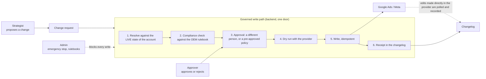
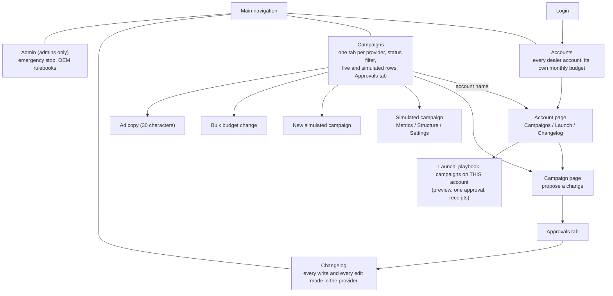
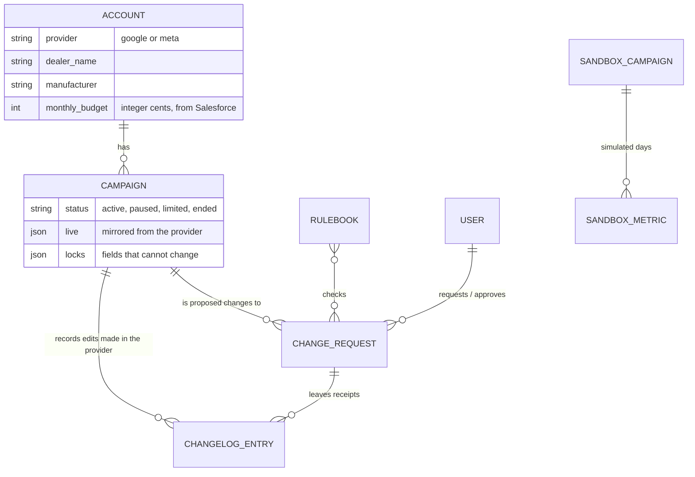

# Stream: product overview

What the app is for, who uses it, what each page is expected to do, and how the project is laid out. For how to run and verify it, see [PROJECT_GUIDE.md](PROJECT_GUIDE.md); for the architecture and the decisions behind it, see [architecture.md](architecture.md) and [adr/](adr/).

## 1. What Stream does

Stream is a campaign operations platform for an automotive marketing agency. It manages paid search and paid social campaigns (Google Ads and Meta) for car dealerships, one **account** per dealer and provider.

It is built around one rule: **every change to a live ad account goes through a single governed write path**. Nobody edits a live campaign directly. A strategist proposes a change, the platform checks it, a second person approves it, and only then is it written, with a receipt in the changelog.



Two areas sit **outside** the governed write path, on purpose, and never touch a real ad account:

- **Simulated campaigns** (the demo sandbox): create, edit and delete campaigns that exist only in Stream, to see the structure and metrics a platform would hold ([ADR 0006](adr/0006-demo-sandbox.md)).
- **Launch, bulk budget change and ad copy**: preview-only operations that run on a mock backend served by the development server. They show how a batch is previewed, approved once, partly fails and is retried, but they write nothing real.

Google Ads and Meta are driven by fakes by default (`PROVIDERS_DRIVER=fake`); the real adapters have never run against a live account.

## 2. Who uses it

Three roles, seeded for the demo (password `password`). A role is checked on the server for every action, not only hidden in the interface.

| Role | Sign in as | Can do | Cannot do |
|---|---|---|---|
| **Strategist** | `strategist@example.com` | Browse accounts, campaigns and the changelog. Propose a change to a live campaign (it waits for approval). Create, edit and delete simulated campaigns. Use the Launch, bulk and ad copy previews. | Approve or reject. See the Admin page. |
| **Approver** | `approver@example.com` | Everything a strategist can, plus approve or reject change requests from the Approvals tab. | Approve a change they requested themselves (four-eyes). See the Admin page. |
| **Admin** | `admin@example.com` | Everything an approver can, plus the **Admin** page: the emergency stop and the OEM rulebooks. | Bypass the approval of a change they requested themselves. |

Who can do what, by page:

| Page | Strategist | Approver | Admin |
|---|---|---|---|
| Accounts, Account page | view | view | view |
| Campaigns (provider tabs, status filter) | view | view | view |
| Campaign page (change form) | propose a change | propose a change | propose a change |
| Campaigns, Approvals tab | see the queue | approve or reject | approve or reject |
| Simulated campaigns (create, edit, delete) | yes | yes | yes |
| Account, Launch tab; bulk budget change; ad copy (previews) | yes | yes | yes |
| Changelog | view | view | view |
| Admin (emergency stop, OEM rulebooks) | no | no | yes |

The emergency stop banner is shown to **everyone** while writes are stopped; only an admin can resume them.

## 3. How the pages fit together



Every page has a breadcrumb; pages reached from another page (Account, Campaign, Simulated campaign, New simulated campaign, Bulk budget change, Ad copy) also have Back. The three main pages never show Back. The selected tab is kept in the address (`?tab=`), so a tab can be linked and reloaded.

## 4. What each page is expected to do

### Login (`/login`)
Sign in with email and password. After signing in you land on the page you were trying to open (never on another site).

### Accounts (`/accounts`)
**Purpose:** find a dealer account and see its budget at a glance.
- A table of every account: dealer, provider (Google Ads or Meta), OEM, **monthly budget**, number of campaigns. The budget belongs to **each account** (it comes from Salesforce); an account without one shows "No budget".
- Filter by provider (with counts), search, sort. Click an account to open it.

### Account page (`/accounts/:id`)
**Purpose:** everything about one account, and the place to launch campaigns for it.
- Header: dealer, provider, OEM, account id, monthly budget.
- **Campaigns** tab: the account's campaigns with status, daily budget and creation date; click one to open it.
- **Launch** tab (development server only): launch the playbook's campaigns on this account in three steps. *Playbook*: the OEM rulebook (starts from the account's own OEM) and which campaigns. *Settings*: the monthly cap, pacing and status at write start from the account's own values and are only editable if you choose "Change for this launch". *Review and deploy*: a preview that writes nothing, with what is ready and what is **held with the reason** (no Salesforce budget, cap above the account's budget, the OEM rulebook does not apply, a campaign breaks a rule). One approval applies the ready ones; failures are listed and can be retried; receipts show who did what and through which steps.
- **Changelog** tab: every write on this account's campaigns, loaded only when you open the tab.

### Campaigns (`/campaigns`)
**Purpose:** work with campaigns one provider at a time, and decide on pending changes.
- **Google Ads** and **Meta Ads** tabs, each with a count. One table mixes **Live** campaigns (read from the provider) and **Simulated** ones (demo), with the account each belongs to (a link to its page), status, daily budget and creation date.
- **Status filter**: All, Active, Paused, Limited (by budget) and Ended, each with a count; combines with the search.
- Row actions: a live campaign offers *Request a change* (it goes through approval, and there is no delete); a simulated one offers *Edit* and *Delete* (after a confirmation).
- *New simulated campaign* opens a form with the platform already chosen from the tab. Under the table, a folded guide lists what each platform collects, with the API field names.
- **Approvals** tab: change requests as a table, pending first. Each pending row has an approve and a reject icon for approvers and admins; strategists see "Waiting for an approver". A blocked request shows which rule it broke. The number waiting is always in the tab label.
- Buttons for **Bulk budget change** (a batch of 300 campaigns: summary, ready and held lists, one approval, 12 failures to retry, receipts) and **Ad copy** (headline templates with placeholders, kept within 30 characters after they are filled in, for every dealer). Both are previews.

### Campaign page (`/campaigns/:id`)
**Purpose:** propose a change to one live campaign.
- A form with the live values (name, status, daily budget). "Submit for approval" stays disabled until something differs from live state. Locked fields cannot be edited and are marked as locked. Submitting sends a request with an idempotency key; a retry never creates a second one.

### Simulated campaign (`/campaigns/simulated/:id`)
**Purpose:** see what a platform would hold for a campaign, and edit it directly.
- **Metrics** (opens first): 30 days of simulated results with the platform's own field names. **Structure**: campaign, ad groups or ad sets, ads, in collapsible sections and a raw payload. **Settings**: edit name, goal, status, budget, vehicle, city and landing page; saving rebuilds the structure and keeps the history. *Delete campaign* asks first.

### Changelog (`/changelog`)
**Purpose:** the record. Every change written through Stream and every edit made directly in Google Ads or Meta (found by polling), with date and time, who did it and who approved it.

### Admin (`/admin`, admins only)
**Purpose:** controls that should not sit in everyone's way.
- **Emergency stop**: explains what it does (no change is accepted or written to any ad account until an admin resumes; campaigns keep running as they are), shows whether writes are enabled, asks for confirmation before stopping, and offers *Resume writes*. A banner on every page tells everyone while it is on.
- **OEM rulebooks**: each manufacturer's rule versions with their effective dates, folded; open one to read its rules.

## 5. How the data fits together



Money is integer cents everywhere; dates leave the API as ISO 8601 and are shown only through the shared formatter ("Oct 15, 2026"). Simulated campaigns have their own tables and no link to accounts or the write path.

## 6. Project structure

```text
stream/
├── backend/                      Laravel 13, PHP 8.4: the API and the governed write path
│   ├── app/Domain/               modular monolith, one folder per bounded context
│   │   ├── Identity/             users and roles
│   │   ├── Advertising/          accounts, campaigns, provider adapters (Google, Meta, fake), state diffing
│   │   ├── Compliance/           OEM rulebooks (versioned, with effective dates) and the engine
│   │   ├── Governance/           change requests, policies, emergency stop, GovernedWritePath, apply job
│   │   ├── Changelog/            receipts and the poller for edits made in the provider
│   │   ├── Playbooks/            strict {{ dotted.path }} template renderer
│   │   └── Sandbox/              simulated campaigns for demos (standalone)
│   ├── app/Http/                 thin controllers, FormRequests in, API Resources out
│   ├── database/                 migrations, factories, seeders (demo data is idempotent)
│   └── tests/                    Pest feature tests and architecture tests that enforce the boundaries
├── frontend/                     Vue 3 + TypeScript
│   ├── src/design-system/        tokens and Ds* components on Reka UI + Lucide (no UI kit)
│   ├── src/shared/               API client and types, formatters, composables, batch preview and receipts
│   ├── src/features/             accounts, campaigns (approvals, simulated, bulk, copy), changelog, system, auth
│   ├── src/app/                  shell, router, header, breadcrumbs
│   ├── e2e/                      Playwright with axe, against a mocked API
│   ├── mock-backend/             dev-only mock for launch, bulk change and ad copy
│   ├── tokens/                   design tokens (JSON) that generate the CSS variables
│   ├── tools/                    checks: licences, traceability, budget, screen lint, DevTools audit, plugin build
│   └── review-fixtures/          five screens that are weak on purpose, to test the reviewer
├── docs/
│   ├── PRODUCT_OVERVIEW.md       this file
│   ├── PROJECT_GUIDE.md          how to run, verify and use the tooling
│   ├── architecture.md, adr/     the map and the decisions
│   ├── standards/                reasoning and checklists (TypeScript, Laravel, HTML/CSS, accessibility, UX)
│   ├── specs/                    screen specs with acceptance criteria
│   └── learning-plan/            coverage of the learning plan, review log, compliance report
├── .claude/                      Claude Code: rules, skills, reviewer agents, hooks, settings
├── .codex/, .agents/, AGENTS.md  generated mirror for the Codex CLI (npm run sync:codex)
├── plugins/                      the front-end setup packaged as an installable plugin (generated)
├── prompts/                      demo prompts, one folder per example, with mockups
└── .mcp.json                     Playwright and Chrome DevTools MCP servers
```

**Dependency direction in the front end** (enforced by ESLint): `app` uses `features`; `features` and `shared` use `design-system` only through its public entry; `design-system` and `shared` never import features or app; features never import each other (they are composed in `app` or share through `shared`).

**The write rule in the back end** (enforced by architecture tests): only the Governance module may use the write side of a provider. Everything else reads.

## 7. Where to go next

| I want to... | Read |
|---|---|
| run it and check it works | [PROJECT_GUIDE.md](PROJECT_GUIDE.md) |
| understand a decision | [adr/](adr/) |
| build or review a screen | [specs/README.md](specs/README.md), [standards/](standards/) |
| see how the learning plan is covered | [learning-plan/](learning-plan/) |
| run the demo | [../prompts/README.md](../prompts/README.md) |
